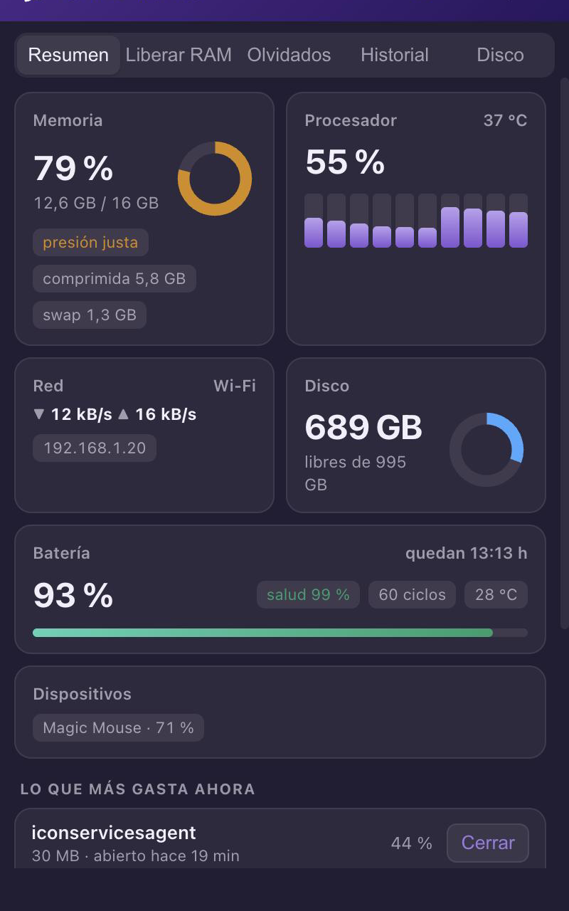
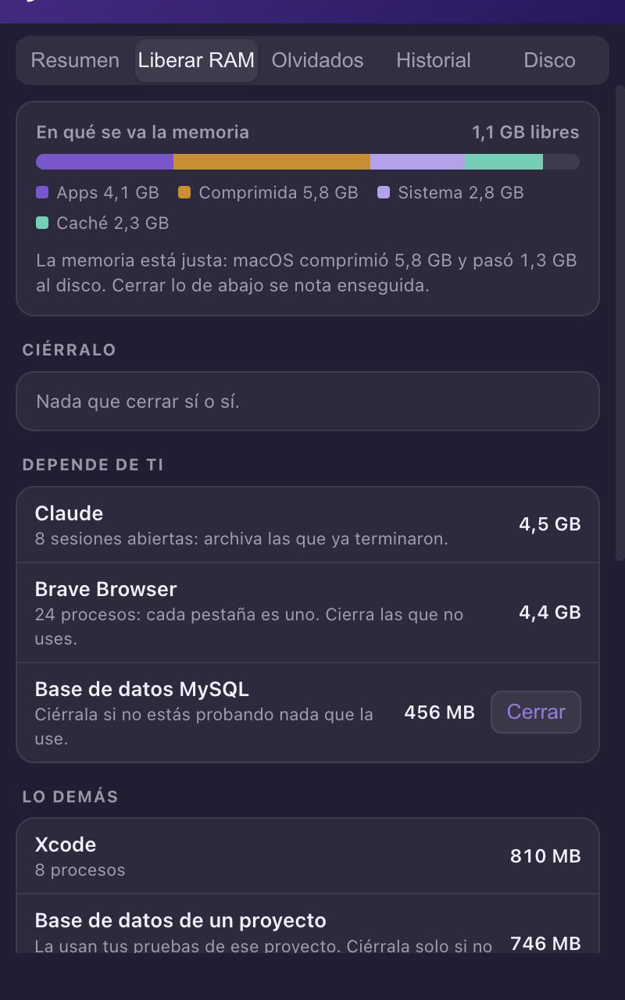

# CAPE Monitor

**Gratis y de código abierto.** Un cohete en la barra de tu Mac que te dice cómo está el equipo, qué está
gastando memoria y batería, y qué puedes cerrar sin miedo.

<p>
  
  
</p>

- **Resumen:** memoria (como la cuenta el Monitor de Actividad, con presión y memoria comprimida), procesador por
  núcleo y temperatura, red, disco, batería (salud igual a la que muestra macOS, ciclos, temperatura) y la batería
  del ratón, el teclado o los AirPods.
- **Liberar RAM:** cuánta memoria usa cada app (todas sus pestañas y procesos juntos) y un consejo para cada una:
  *Ciérralo* · *Depende de ti* · *Lo demás*.
- **Olvidados:** servidores de prueba y navegadores automáticos que quedaron abiertos sin dueño. Se limpian solos
  cada 15 minutos; nada más se cierra sin que tú lo digas.
- **Historial** de 1 hora, 24 horas y 7 días.
- **Disco:** qué carpetas ocupan más (Descargas, cachés, Docker, Papelera…).
- **Avisos** solo cuando algo es raro: un programa al 80 % de CPU por 10 minutos, disco casi lleno, memoria al límite.

Se abre con un clic en el cohete o con **⌘⇧M**, y arranca sola al encender el Mac. Gasta menos de 1 % de CPU.

## Descargar

1. Entra a [**Releases**](../../releases/latest) y baja `CAPE-Monitor-mac.zip` (macOS 12 o más nuevo; sirve para Mac con chip Apple
   y con Intel).
2. Descomprímelo y arrastra **CAPE Monitor** a **Aplicaciones**.
3. La primera vez macOS dirá que no puede comprobar la app (no está firmada con un certificado de Apple de pago).
   Ábrela una vez, cierra el aviso y ve a **Ajustes del Sistema → Privacidad y seguridad → «Abrir igualmente»**.
   O, en la Terminal:
   ```bash
   xattr -dr com.apple.quarantine "/Applications/CAPE Monitor.app"
   ```
4. **¿No ves el cohete?** En **Ajustes del Sistema → Barra de menús → Permitir en la barra de menús**, enciende
   CAPE Monitor. Mientras tanto, **⌘⇧M** abre el panel igual.

## Construirla tú mismo

Si prefieres no bajar nada ya hecho, compílala desde este código (unos 5 minutos la primera vez). Necesitas
macOS 12 o más nuevo, las herramientas de Xcode (`xcode-select --install`), [Rust](https://rustup.rs) y
[Node.js](https://nodejs.org).

```bash
git clone https://github.com/JuanP30/cape-monitor.git
cd cape-monitor
npx -y @tauri-apps/cli@2.12.1 build --bundles app
cp -R "src-tauri/target/release/bundle/macos/CAPE Monitor.app" /Applications/
open "/Applications/CAPE Monitor.app"
```

Pruebas (reglas de «olvidado», memoria, consejos y batería): `cd src-tauri && cargo test`.

¿Usas un asistente de IA (Claude Code, Codex, Cursor…)? Pídele: *«clona github.com/JuanP30/cape-monitor,
constrúyela e instálala siguiendo el README»*.

## Para asistentes de IA (opcional)

La app deja el estado del Mac en `~/.cape/monitor/estado.json`. El comando `cliente/cape-monitor` lo resume y
permite **pedir** cerrar algo: la app te pregunta y tú apruebas en el panel. Para instalarlo:

```bash
mkdir -p ~/.cape && cp cliente/cape-monitor ~/.cape/cape-monitor
bash ~/.cape/cape-monitor            # resumen: memoria por app, lo que más gasta, olvidados
bash ~/.cape/cape-monitor json       # todo el estado
bash ~/.cape/cape-monitor cerrar <pid> "<motivo>"   # lo apruebas tú en el panel
```

## Privacidad

Todo se mide y se guarda en tu Mac (`~/.cape/monitor/`). Lo único que sale a internet es una consulta a
`api.ipify.org` para mostrar tu IP pública en la tarjeta de Red. No hay cuentas, analíticas ni rastreo.

## Desinstalar

Desactiva «Abrir al iniciar sesión» si quieres, cierra la app y bórrala:

```bash
pkill -x cape-monitor; rm -rf "/Applications/CAPE Monitor.app" ~/.cape/monitor ~/.cape/cape-monitor
rm -f ~/Library/LaunchAgents/CAPE\ Monitor.plist
```

## Licencia

[MIT](LICENSE): úsala, cámbiala y compártela libremente.

Hecha con [Tauri](https://tauri.app) y [sysinfo](https://github.com/GuillaumeGomez/sysinfo).
